# 09-11-2026 / maandag kick-off [sprint 0]

## **Check-Out vragen**

**Leg uit wat een source hosting platform is en voor welke jij gekozen hebt.**

- Github, dat is een platform waar je je werk op commit en opslaat, zodat je je werk kan bijhouden als voortgang voor je uiteindelijke html site. Ook is het dus ook een platform waar je je website online kan publiceren.

**Vertel welke domeinnaam jij gekozen hebt en hoe je die hebt gekoppeld aan jouw pagina.**

- "Cakirey", gewoon mijn volledige naam.

**Beschrijf hoe je aanpassingen aan jouw pagina kunt maken en hoe je er voor zorgt dat die op het web gepubliceerd worden.**

- Wanneer je werk hebt verricht op VSCode, commit je dit en zet je er een comments bij, als annotatie voor wat je hebt aangepast. Nadat je het hebt gepusht kun je het runnen en op een browser neergeven.

**Beschrijving:** Dit is een afbeelding van een vraag die ik heb gesteld aan AI, over hoe ik mijn ReadMe indeling kan verbeteren zodat het er frisser en netter uitziet.

## **Zelftest**

 

**Beschrijving:** Het viel me op dat deze zelftest wat soepeler ging dan de zelftest die ik vorig jaar heb gemaakt met dezelfde vragen. Dit betekent ook dat ik dus meer dingen beheers en weet van de theorie. Ik heb weinig dingen die ik helemáál niet ken. 

## **Kleine aanpassinkjes html**

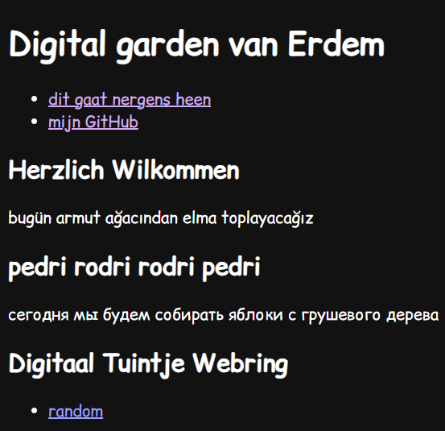

# 11-11-2026 / woensdag (interactie & schetsen/interactie) [sprint 0]

## **Wok to Walk menu opdracht**

**Beschrijving:** De 1e afbeelding zie je mijn eerste geschetste versie van de WoktoWalk menu. In mijn gedachte had ik al gelijk dat ik een soort luxe menu ervan wilde maken, michelin achtig iets, maar nog wel met dezelfde concept, elementen en fonts. Ik probeerde het heel simpel te houden en logisch, dus heb ik ook de volgorde en plaats van de saus elementen aangepast, voor verduidelijking.

Op de 2e afbeelding zie je de uitgewerkte versie op Figma. Heb het simpel gehouden, maar wel passende en nuttige elementen toegevoegd, zoals natuurlijk de titel Wok to Walk, de logo rechtsboven, en natuurlijk de kleuren en fonts. Een extra element dat ik erbij vond passen is afbeelding van de sauzen ernaast zetten. Uiteindelijk als interactie kun je op die sauzen klikken, en krijg je een grotere afbeelding met de ingredienten van de saus tevoorschijn.

## **De basis van schetsen opdracht**

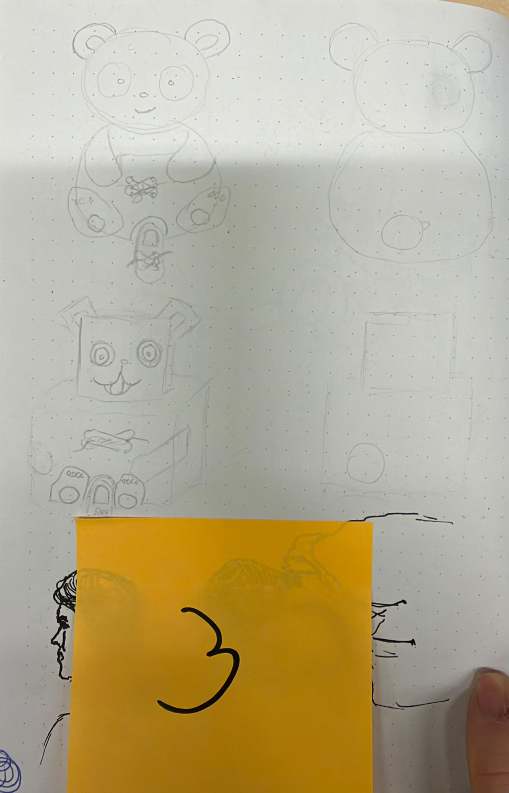

**Beschrijving:** Hier zie je een wat mindere schets. Redenen zijn omdat er weinig variatie is, weinig pogingen, en weinig creativiteit, en vast meer dingen waar ik even niet op kom.

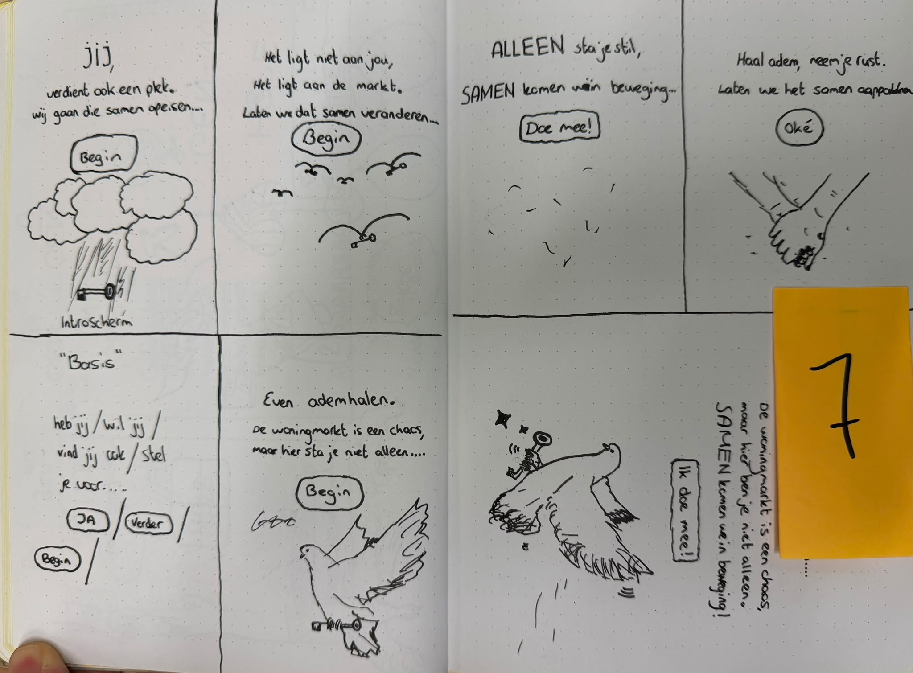

**Beschrijving:** Dit ziet er beter uit. Er zijn veel pogingen gedaan, ze varieren van elkaar, ze zijn duidelijk, er is aandacht aan besteed door het te verduidelijken met een pen, en dat was 't eigenlijk.

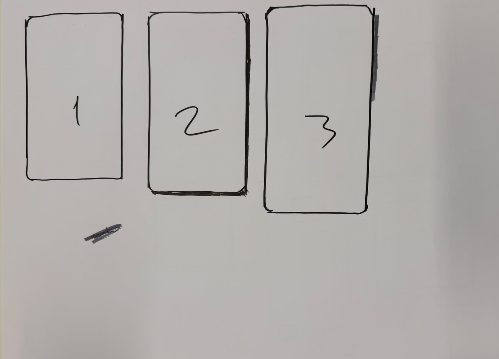
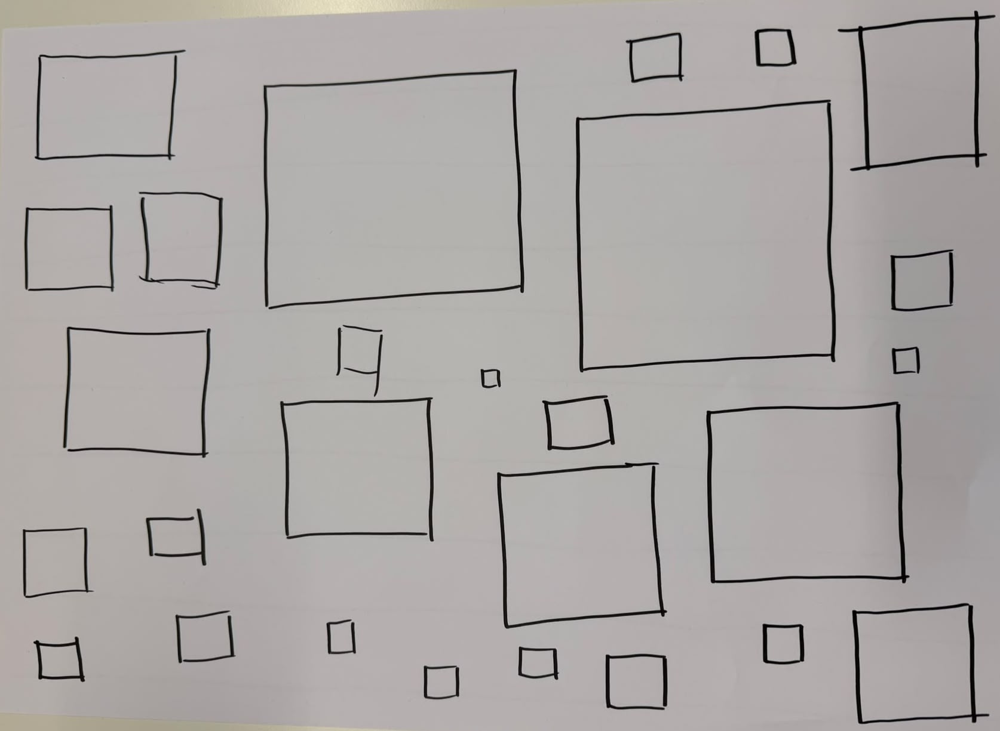
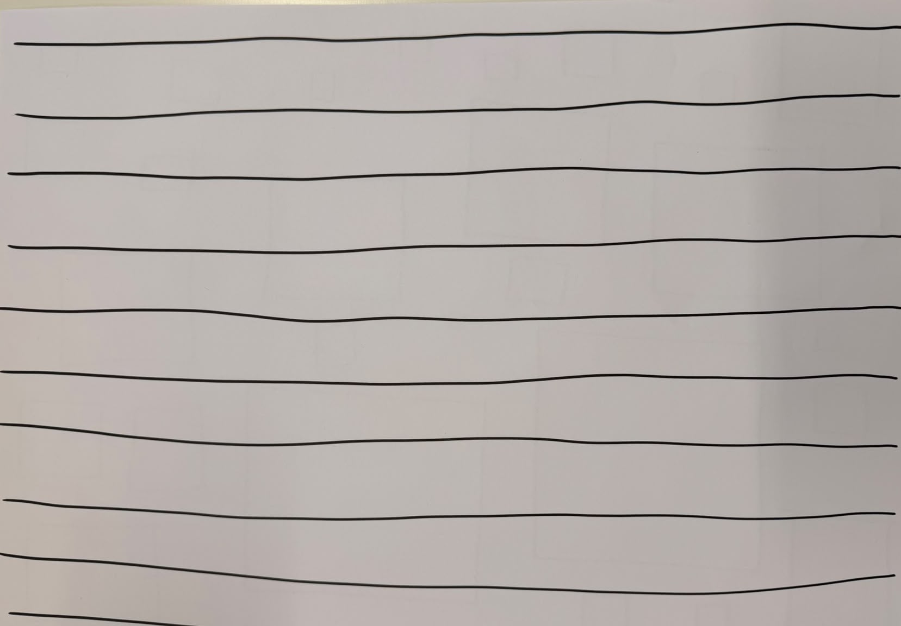
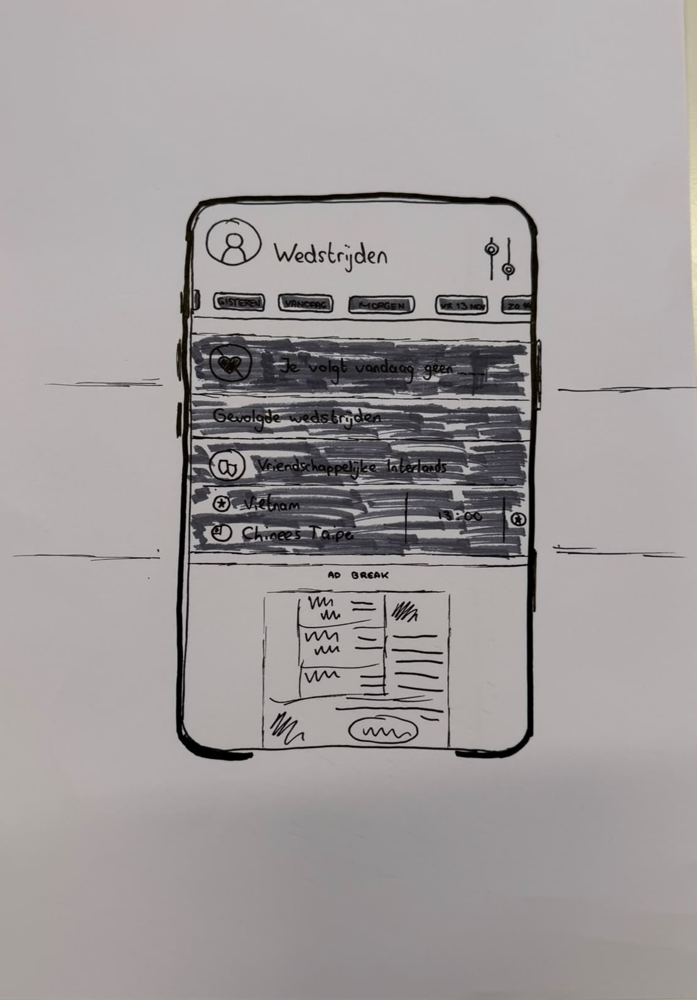

**Beschrijving:** Het voelde best fijn en grappig eigenlijk om deze schetsen te maken. Omdat ze natuurlijk heel simpel zijn, maar de vraag is dus of simpel ook makkelijk is. Persoonlijk vond ik dat ik het best goed deed, en daagde ik mijzelf ook tijdens het schetsen uit, door bijvoorbeeld de ene keer met links te schrijven, en de andere keer zonder te kijken. De telefoon app schets ging iets minder, omdat ik de grootte en maten van sommige elementen verkeer had ingeschat. Dit betekent dus eigenlijk niks anders dan dat ik de volgende keer een betere planning moet maken, ook met zulke simpele schetsen waar niks fout kan gaan. Maar tegelijkertijd denk ik ook dat dat part of the process is, en schetsen natuurlijk niet perfect moet zijn, maar alsnog...

# 13-11-2026 / vrijdag (praktische css & css met fonts) [sprint 0]

## **Een lelijke HTML pagina maken**

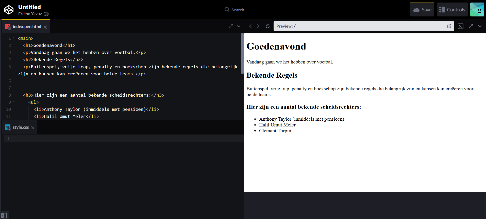

**Beschrijving:** Dit was de eerste versie van een lelijke html pagina maken. Ik heb de basis toegevoegd, namelijk de titels en de paragrafen/kopjes, samen met een lijstje van scheidsrechters.

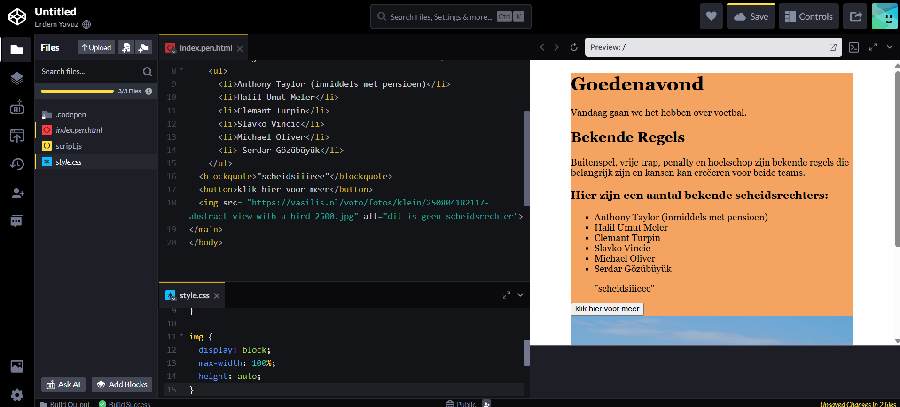

**Beschrijving:** Hier heb ik extra dingen toegevoegd, zoals een achtergrond, langere lijst, een knop, en een afbeelding. Alleen lukte het me niet om de achtergrond over de gehele pagina te krijgen. Ik had wat verkeerd gedaan.

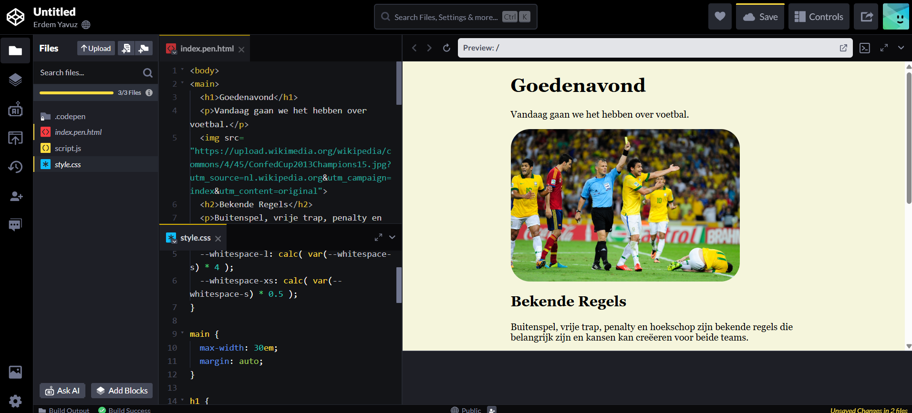

**Beschrijving:** Dit was het resultaat. Het zag er allemaal veel netter en smoother uit, de achtergrond was gefixt met behulp van de docent. Ik had de achtergrond color onder de verkeerde element gezet. De font was ook aangepast, maar het belangrijkste is dat hij niet meer lelijk was.

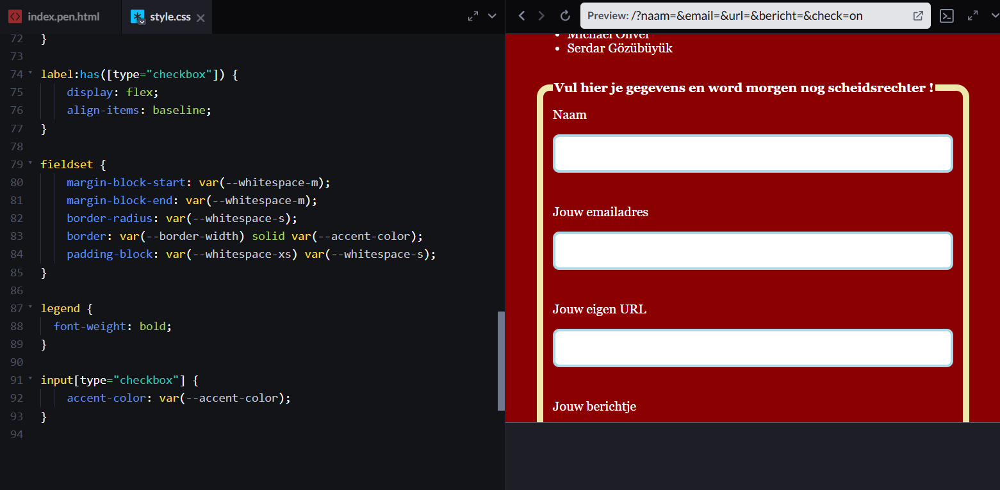
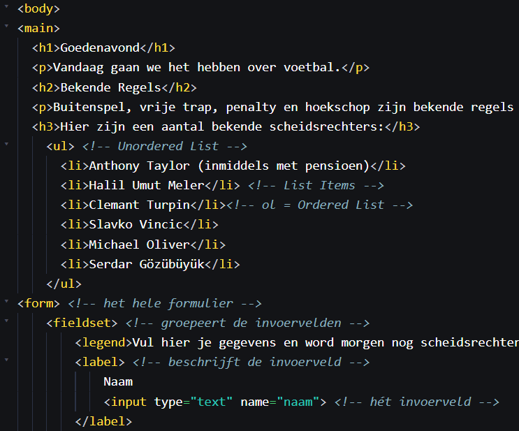

**Beschrijving:** Achteraf terugkijken, kwam ik erop dat ik helemáál niet klaar was, dus heb ik het even toch nog afgemaakt. Ik heb geprobeerd de code écht te begrijpen, en niet gewoon de opdracht gekopieerd en geplakt. Dat is best moeilijk, omdat je pas kennis maakt met allerlei termen, dus om eerlijk te zijn ben ik nu nog een beetje gespannen hierover, maar ik hoop dat het met de tijd mee zal verbeteren. Ik heb hierbij ook comments toegevoegd naast de code, omdat ik zeker weet dat ik deze codepen file ga gebruiken voor m'n toekomstige site, en terug ga kijken hoe ik dingen ook alweer had gedaan, en daarbij is het handig dat er nu al definities bij staan. Ik heb uiteindelijk ook een beetje de kleuren gebruikt die ik later in m'n site zou willen gebruiken, zodat het alvast een beetje een voorproef is. Voor wie? Geen idee. Voor mezelf?...

# 18-11-2026 / woensdag (visual research) [sprint 1]

## **Opdracht 4: Eigen verbinding (presentatie vragenlijst)**

**Wat is voor jou de essentie van wat je hebt gepresenteerd qua onderwerp en geschreven/beeldende content?**

- Sfeer, kleuren, motieven zoals rozen, de algemene kunst.

**Wat is het karakter/ de uitstraling/ het gevoel dat bij het onderwerp past? (bijv. stoer, hip, vrolijk, dynamisch, eenvoudig, enz.)**

- Identeit, trots, machtig, krachtig, fascinatie, tegelijkertijd rustgevend, perfectie.

**Welke inspiratie kun je uit je 25 afbeeldingen halen. Stijl, een gevoel, vorm, enz.**

- De vibes die de kleuren geven, donkerrood, soorten blauw, groenig, goud.

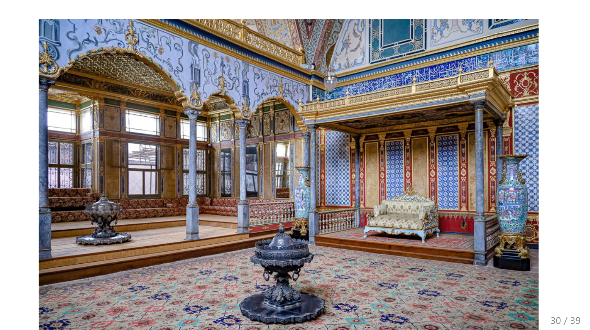

**Beschrijving:** Hier ze een afbeelding die ik heb getoond tijdens de presentatie. Je ziet hier duidelijk stevige duidelijke kleuren, waar op het gebied van design een styleguide van gemaakt kan worden. Het ziet er krachtig uit, en het klopt allemaal.

**Aanvullende ideeën:**
- Zou leuk zijn als het een soort museum wordt, alsin my digital museum, waar je kunst laat zien en dingen erover uitlegt. voeg je eigen twist eraan toe, zoals een zelfgemaakte border dat wel dezelfde vibes een beetje geeft.

## **Opdracht 4: Een stip op de horizon (presentatie vragenlijst)**

**Wat zou je willen vertellen over het onderwerp aan een ander? en hoe zou je dat voor je kunnen zien? middels welke beeld, tekst, animatie, inhoudelijke content? (bijv. Ik wil voornamelijk afbeeldingen tonen, als een soort Pinterest, of ik wil muziek fragmenten laten horen, of ik gebruik korte teksten met eigen foto's).**

- Ik zou graag voornamelijk de Ottomaanse sfeer willen tentoonstellen. Denk daarbij aan afbeeldingen voor de achtergrond, versiering, informatie.
Ook kun je denken aan de klassieke westerse architectuur, bijvoorbeeld op paleizen, kasteels, of gebouwen met status. Deze architectuur heeft 
veel overeenkomsten met de Ottomaanse architectuur, en zijn er in de geschiedenis veel afwisselingen en overnemingen geweest tussen de 2 regio's.
Dus ik denk dat ik het redelijk simpel ga houden en vooral ga focussen op design en minder op interactie. Ook wil ik een typische "ney" fluitinstrument op de achtergrond laten afspelen.

**Vul deze zin aan:**

- Ik wil mijn Digital Garden laten gaan over Ottomaanse kunst
en wil dat laten zien door sfeer, afbeeldingen, architectuur, kunst en gevoel aan content te tonen.
Ik begin met een stukje eigen content over een passende introductie, of misschien juist een originele interactie met een specifieke element van content dat ik wil gebruiken. Dit wordt ondersteund met passende fonts en afbeeldingen.
Als het begin is gemaakt kan ik mijn Garden verder uitbreiden door opties toe te voegen, bijvoorbeeld een navbar, waarbij ik misschien wat over mezelf vertel, of iets uitleg over mijn onderwerp, etc.

## **Opdracht 5: Sfeerwoorden**

- Mijn onderwerp is het Ottomaanse rijk, en ik ben van plan om een focus te leggen op kalligrafie, kunst, miniaturen, designs, portretten, schilderijen, en symbolen zoals moskeën en rozen.

- Mijn sfeerwoorden hierbij zijn: krachtig, machtig, donker, vol, niet-minimalistisch?, bloemen, rozen, natuurlijk, religie, classy, klassiek. 

## **Opdracht 6: Directe visuele vertaling**

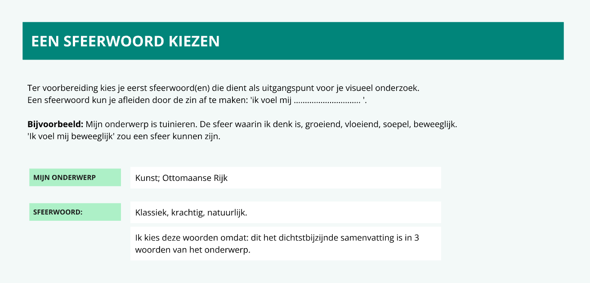

**Beschrijving:** Ik koos voor deze 3 sfeerwoorden, omdat ze naar mijn mening het meest gevarieerde waren, en ik dus een beetje van meerdere kanten ideen bij elkaar kon verzamelen.

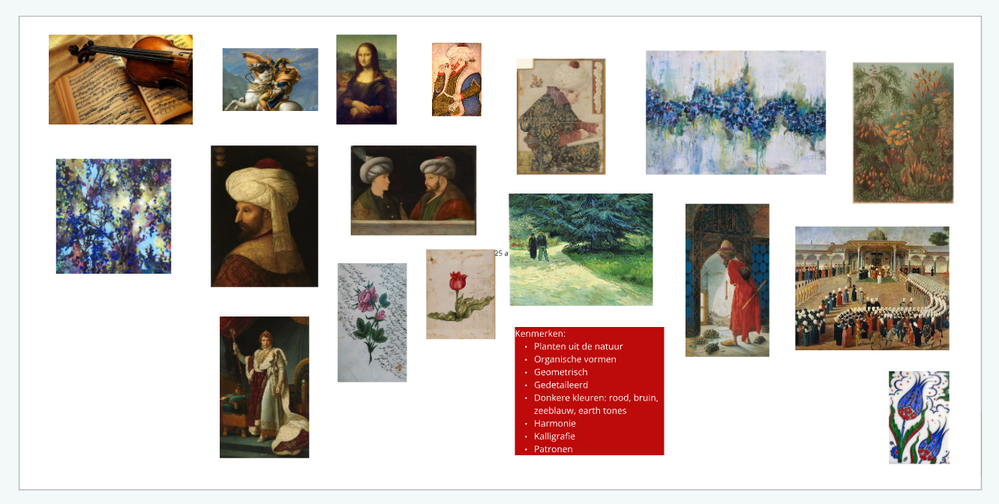
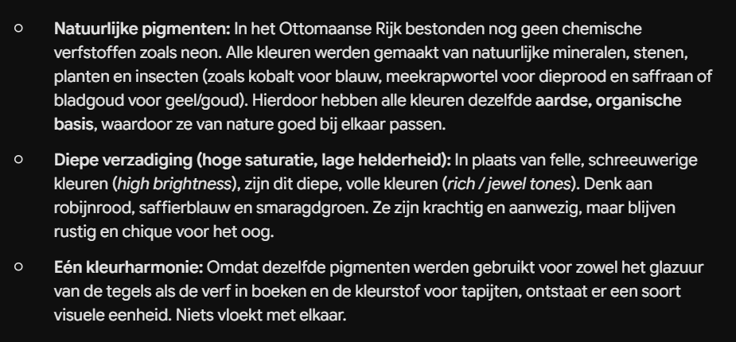

**Beschrijving:** Ik zocht naar dingen die ik in de afbeeldingen herkende, maar gewoon niet kon beargumenteren. Daarom heb ik AI gevraagd. Het viel me namelijk op dat de kleuren die worden gebruikt in de afbeeldingen, eigenlijk allemaal heel sterke kleuren zijn, maar ook dichte kleuren(ofzoiets). Geen één kleur valt écht op, maar ze passen wel allemaal bij elkaar, en dan heb ik 't vooral over de Ottomaanse afbeeldingen. Dit komt blijkbaar omdat ze allemaal heel natuurlijke kleuren zijn, letterlijk. Er wordt niet gebruik gemaakt van chemische en kunstmatige ingredienten. Ze hebben allemaal een organische basis. Zo onstaat er een visuele kracht en aanwezigheid. Kleur is heel belangrijk. Ik zie de rode bordeaux kleur bij bijna alle afbeeldingen terug, samen met bruin, en eigenlijk de earth tones dus. Dit zijn kleuren die macht uitstralen volgens mij. Dit zie je ook terug in het schilderij van Napoleon. Tegelijkertijd geeft dit een rustgevend gevoel, het laat je ogen geen overuren maken. De kenmerken die ik eraan heb gekoppeld zie je terug in de afbeelding, gemaakt met behulp van Charley, omdat ik niet gelijk wist wat voor termen ik zou kunnen gebruiken hiervoor. Het moest blijkbaar heel algemeen blijven.

## **Opdracht 7: Abstracte vertaling**

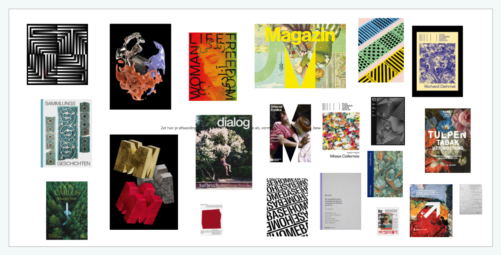

**Beschrijving:** Hier heb ik naar de site, en tegelijk naar de kenmerken gekeken, en gescrollt of ik wat kon vinden dat elkaar ondersteund. Zo zie je bijvoorbeeld veel bomen en planten, details op soortvan schilderijen, passende kleuren die ik ga gebruiken, kalligrafie waar verschillende lettertype's worden gebruikt, en patronen en harmonie zie je terug bij de wat modernere kunstwerken.

## **Opdracht 9: Crazy 8**

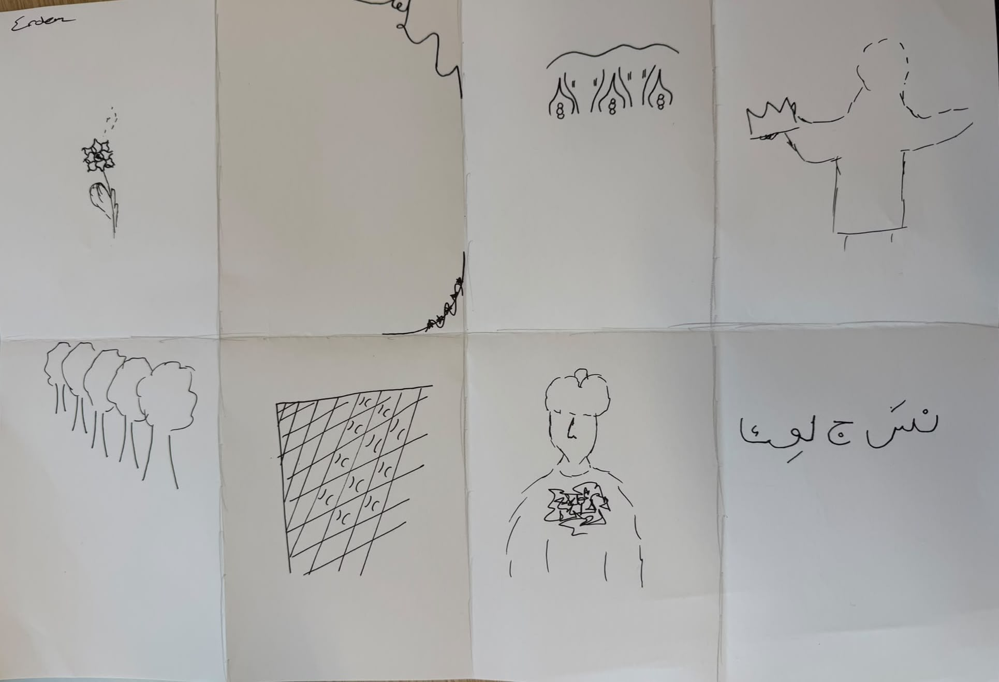

**Wat zijn de beste ideeën en waarom? ... en waarom de andere minder?**

- De turkse tekst (volgens het arabische alfabet) is toch wel één van de betere. Vooral omdat je visueel eigenlijk wel wat moet laten zien, en ik dit ook heel belangrijk vindt. Als je bijvoorbeeld kijkt naar alle eindproducten dat studenten hadden, viel het me op dat ze allemaal heel anders waren, en het leek alsof ze alles hebben kunnen gebruiken wat ze wilden gebruiken. Denk bijvoorbeeld aan verschillende lettertype's (die soms er niet bij passen), of verschillende talen zelfs, elementen, poppetjes, noem 't maar op. Dus ik denk dat dat heel passend ka zijn bij zo een site als de mijne. De planten en de border design (2e) zijn ook goede ideen die ik zou willen implementeren. Ottomaanse kunst is namelijk grotendeels, bloemen, tulpen en specifiek gedetailleerde design.

**Zijn uitgangspunten terug te zien in de schetsen? Hoe is dat zichtbaar?**

- Ja. De planten geven een natuurlijke kenmerk, de 3e Ottomaanse "çini" afbeelding geeft een duidelijke detail kenmerk, de afbeelding rechtsboven geeft een machtige kenmerk aan.

**Is het idee online te vertalen? Hoe zouden vorm/ kleur of typografie in een schermontwerp kunnen worden getoond?**

- Jazeker, veel van deze schetsen zijn ook mijn laatste gedachtes van de afbeeldingen van mijn presentatie, bijvoorbeeld de 3e çini tegels schets, zou je online kunnen gebruiken als achtergrond, border, noem t maar op. Ik had ook in de presentatie wat site ideen toegevoegd, en dat bewijst het ook.

**Is het idee expressief? Zit er genoeg uitdaging is? Ga je hiermee nieuwe CSS technieken leren? Zie je animaties of transities voor je?**

- Dat zou wel moeten. Om de borders bijvoorbeeld de juiste vorm te geven ga je inderdaad iets eraan moeten te doen. Of bijvoorbeeld hoe ik bepaalde elementen zoals bloemen op de goede plaats kan zetten. Ik weet nog niet hoe ik interactie erin zal toepassen, en hoeveel. Nour gaf me een idee om een soort museum ervan te maken, waar je verschillende elementen hebt, erop kunt klikken en er een uitleg bij krijgt.

**Is het idee leuk en verrassend? Heb je zin om 'dit ontwerp' te maken?**

- Zeker, maar heb wel soms twijfels of ik daadwerkelijk mijn volle creativiteit kan gebruiken. Meestal is het zo met ontwerpen waar ik mijn eigen onderwerpen aan kan verbinden, dat ik dan heel veel ideen heb maar alsnog focus op enkele stukken ervan, waardoor ik uiteindelijk niet helemaal tevreden ben met het resultaat.

# 20-11-2026 / vrijdag (eerste schermen schetsen) [sprint 1]

## **Mobile first schetsen**

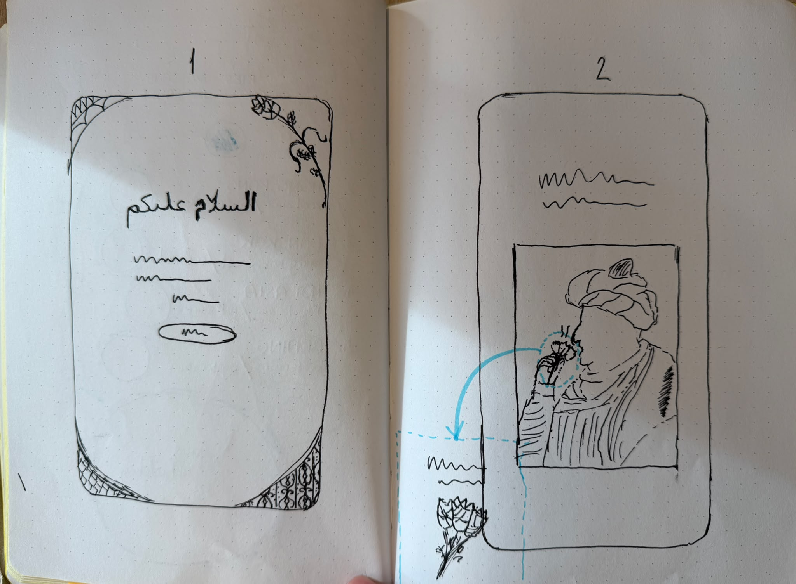
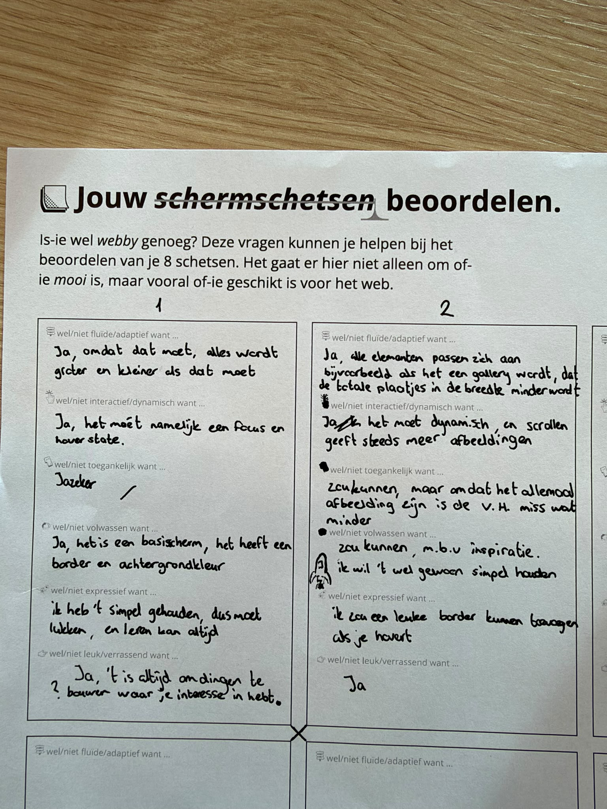

**Beschrijving:** Dit zijn de (helaas 2) mobile schetsen die ik heb kunnen maken. De eerste heb ik gefocussed op een aantal elementen in de schetsen van de crazy 8, namelijk de 1e, 2e, 3e en de laatste. De main element is hierbij de border/randjes, waar ik nog geen definitieve keuze heb gemaakt over wat voor border ik ga gebruiken. Als je er zo naar kijkt passen ze allemaal wel bij zo een beginscherm dat Ottomaanse vibes moet geven. Zo een beginscherm is niet definitief, dus misschien gebruik ik dit niet eens in m'n site, maar 't zorgt in ieder geval voor brainstorm. 

De tweede schets gaat over de 1e en 7e eigenlijk, waarbij je door schilderijen heen gaat en klikt op 1tje, waardoor je een uitleg over krijgt, bijvoorbeeld de oorsprong, motieven, designkeuzes, etc. Dit zou ik kunnen ondersteunen door juist interactie te kunnen toevoegen, door op een element te kunnen klikken en daar weer uitleg over te krijgen zoals de roos die je ziet. 

Uiteindelijk heb ik mijn schetsen beoordeeld of basis van of ze webby zijn. Vond dat wel lastig, omdat de meeste dingen niet gelijk te zien zijn in de schetsen zelf, dus zou je je gedachten eigenlijk moeten gebruiken, om bijvoorbeeld te beoordelen of er een light/darkmode aanwezig is, of dat de visuele hirarchie van pas komt. Toekomstig beantwoorden als het ware(?).

## **Feedback Justus & Charley**

- Maak onderzoek over fonts die je wilt gebruiken. Ga je bijvoorbeeld arabische letters gebruiken, zo ja hoe? Hoe ga je dat in je site verwerken? 

- Overweeg wat voor soort kunst je wilt gebruiken. Bijvoorbeeld, alleen Ottomaanse kunst dat gemaakt is binnen het rijk, of ook buitenlandse bronnen? 

**Hierna wist ik al wat ik nodig had, meer site inspiraties en een styleguide, wat ik nog niet had gemaakt. Over de fonts, wil ik het gaan mixen. Het moet natuurlijk te lezen zijn en te begrijpen, dus ik ben van plan om bijvoorbeeld titels van afbeeldingen/kunstwerk in het arabisch turks samen met latijns turks weer te geven, en daaronder de beschrijving in het engels waarschijnlijk. Ik ben er achter gekomen namelijk dat er heel weinig tot geen websites beschikbaar zijn die lijkt op wat ik ongeveer wil maken. Zelfs niet een beetje. Dus als dit later gepubliceerd wordt wellicht dat andere mensen hiermee kunnen werken wereldwijd.**

## **Styleguide**

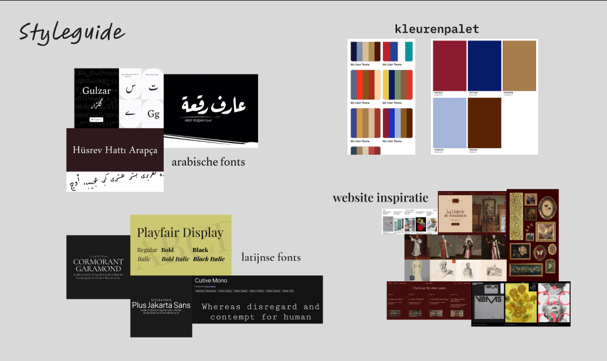

**Beschrijving:** Zoals ik zei heb ik gekozen voor latijns ottomaans, en arabisch ottomaans qua taal. Grotendeels natuurlijk latijns, anders kan niemand het lezen, en een klein stukje arabische letters, zodat het die ottoman vibe kan afgeven. De arabische letters ben ik van plan om alleen bij titels te gebruiken van kunstwerk waarop geklikt wordt, dat ook gewoon wordt ondersteund door ernaast de latijnse versie te geven.

Qua fonts ben ik gegaan voor klassieke fonts dat zou kunnen passen bij een klassieke art gallery museum. Maar ik zou daar nog dingen kunnen toevoegen naarmate ik meer onderzoek doe naar inspiraties. Ook ben ik op zoek gegaan naar de perfect ottomaanse font. Het ottomaanse rijk gebruikt namelijk grotendeels een specifieke vormgeving bij haar letters. Ik heb dezelfde gevonden, en daarnaast een paar die erop lijken. Of ik dit daadwerkelijk ga kunnen gebruiken in VSCode en of het gaat werken, komen we later achter. 

Voor de kleurenpalet heb ik adobe gebruikt. Ik heb gekozen voor afbeeldingen uit mijn digital garden presentatie die het meest eruitstoken met de kleuren (zie afbeeldingen). Ik heb een stuk of 7 afbeeldingen van kunst, paleizen, interieurs, etc. de kleuren vastgesteld, en uiteindelijk met elkaar vergeleken welke kleuren het meeste voorkwamen. 1 overduidelijk was bijvoorbeeld de bordeuax rode kleur. Dat wordt ook de mainkleur als thema voor mijn site. Uiteindelijk heb ik er 1 kleurenpalet van gemaakt, die ik het meeste wil aanhouden, maar hoogst waarschinlijk voeg ik nog andere kleuren toe of haal ik sommige weg. Ik twijfels trouwens eigenlijk ook hoe ik deze kleuren überhaupt ga gebruiken, want mijn concept is redelijk simpel, waarbij veel kleuren eigenlijk niet van pas komen naar mijn gevoel, maar dat zie ik wel.

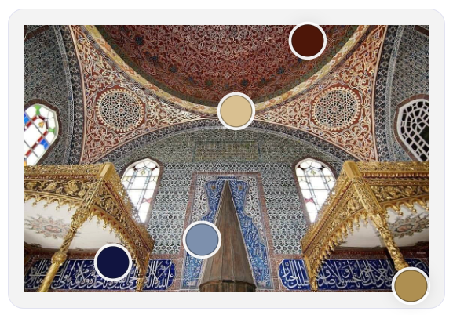

Tot slot heb ik website inspiraties er ook bij gezet, zodat ik niet steeds lang hoef te zoeken naar eigenlijk mijn uitgangspunten, maar ik gewoon snel naar die styleguide kan kijken, en snel kan brainstormen als dat nodig is. 

## **Schetsen beoordeling; webby of niet?**

